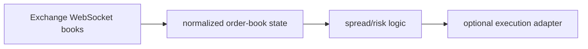

# Perpetual Spread Analyzer

**Cross-market order books, spread research and separate execution adapters.**

  [](LICENSE)

[Overview](#overview) · [Quickstart](#quickstart) · [Example](#example) · [Validation](#validation) · [Documentation](#documentation)

## Overview

An experimental perpetual-market toolkit with order-book handling, spread analysis and exchange execution integrations.

**Stack:** Python · httpx · websockets · sortedcontainers · cryptography · Paradex SDK

## Signal generation and order execution are distinct

| Component | Behavior |
| --- | --- |
| Books | Exchange integrations normalize market observations. |
| Analysis | Spread and risk modules evaluate cross-market conditions. |
| Execution | Separate adapters implement exchange order/signing paths. |

## Processing path



## Quickstart

```console
python -m venv .venv
# Activate .venv, then:
python -m pip install -r requirements.txt
python -m unittest discover -s tests -p test_offline_rounding.py -v
```

The commands above install prerequisites or run the specified offline checks. Live collection, cloud operations, messaging and trading are separate operational steps when present.

## Example

**Inspect the workflow**

Use the focused rounding suite to inspect an offline exchange-boundary case with an in-memory SDK replacement. Follow a normalized book into spread logic before considering any execution command. A quoted spread is distinct from a filled trade after fees and slippage.

## Configuration and storage

Python, HTTP/WebSocket clients and exchange SDK integrations. [.env.example](.env.example) names credentials and dry-run settings. Root requirements do not declare a database; market/execution state is primarily in memory.

## Repository guide

| Location | Responsibility |
| --- | --- |
| [bot/engine/detector.py](bot/engine/detector.py) | Spread detection |
| [bot/engine/executor.py](bot/engine/executor.py) | Execution boundary |
| [bot/exchanges](bot/exchanges) | Exchange integrations |
| [tests/test_offline_rounding.py](tests/test_offline_rounding.py) | Focused offline regression |

## Validation

These checks use offline fixtures or controlled backends.

## Scope and operational boundaries

Legacy scripts named test may query exchanges or place real orders. The focused offline suite is deliberately separate. No latency, execution-quality or profitability guarantee follows from it.

## Documentation

- The repository guide above links directly to the implementation and configuration files.

## License and attribution

Project-authored source code is licensed under the [MIT License](LICENSE). Third-party components and datasets retain their respective rights and licenses.
